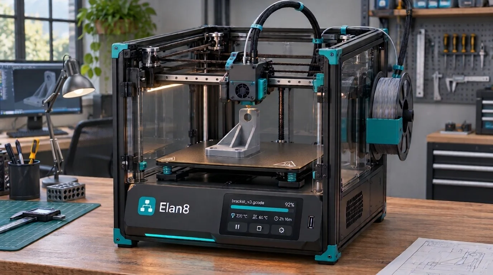

# Desktop 3D printer (SysML v2)



*AI-generated concept illustration of the printer.*

A desktop fused-filament printer for an engineering team that prints functional prototypes: brackets, jigs and
fit checks, in PLA, PETG and ABS. It is a worked example of a model-based systems engineering project that
carries the engineering from the stakeholders' needs to **verification by simulation of the real firmware**, and
ends in generated documents. A small system with real trade-offs between accuracy, stiffness, speed and cost, and
a lot of control engineering: motion planning with input shaping, heater control and fault monitoring.

> **Status: a showcase, not a certified design.** The figures are working assumptions (`ProjectAssumptions`)
> to be replaced by sourced values. Nothing here claims compliance with any regulation or standard.

## The reference scenario

A 100 mm by 100 mm by 20 mm functional bracket, printed with 0.2 mm layers and 0.42 mm lines at up to 300 mm/s
in PETG at 240 degC with the bed at 80 degC. It has to be done within the hour, to a tenth of a millimetre,
without ripples behind the corners, in a shared office.

Speed meets stiffness at the axis: the toolhead's moving mass on the belts and the frame is a spring with a
resonance, and every acceleration shakes it. The controller's input shaper, the motors, the belts and the frame
decide how fast the printer can go before the vibration shows in the part.

## What is in the model

| Area | Where |
| --- | --- |
| Context, stakeholders, reference print and assumptions | `model/00_context` |
| Operational scenarios (use cases) | `model/10_usecases` |
| Stakeholder requirements, in their own words (12) | `model/20_requirements` |
| The printer's specification, limits and 20 measurable system requirements, with derivations | `model/60_systems/00_FdmPrinter` |
| Six subsystems (motion structure, motor drive, hotend, bed, power supply, control), each with a contract and two or three designs | `model/60_systems/*System` |
| The architecture, which rolls their properties up, and six candidate integrations | `00_FdmPrinter/system.sysml` |
| Architecture trade study, generated from the model | `docs/trade-study.md`, `scripts/trade_study.py` |
| Decision record for the lead candidate | `records/ADR-001-lead-architecture.md` |
| One axis: stepper, pulley, belt and carriage, with Modelica reference cases | `model/70_verification/AxisPlant.sysml`, `tests/modelica`, `docs/axis-model.md` |
| The axis controller firmware (three drives) and its verification by simulation (SYS-006, 007, 008) | `firmware/axis-controller`, `model/70_verification/AxisVerification.sysml`, `verification`, `scripts/axis_design.py`, `docs/axis-verification.md` |
| Two-motor CoreXY plant and diagonal verification | [CoreXY motion model](docs/corexy-model.md) |
| Directional moves and corner design study with its simulation data | [CoreXY toolpath verification](docs/corexy-study/README.md) |

Each system requirement constrains a property of the specification against a number in `Limits`, and
`Traceability` links it to the stakeholder needs it serves.

## Where it is going

1. **Context, use cases and requirements**: done.
2. **Architecture alternatives**: done for the first pass. Six candidates are compared against the 17
   requirements the architecture decides. The lead candidate (proposed in ADR-001) is a CoreXY on an extrusion
   frame with closed-loop steppers, a high-flow hotend and a 32-bit board with input shaping. A bed-slinger cannot
   reach the resonance whatever the electronics, and without the shaper the CoreXY just misses the ringing limit.
3. **One axis**: a stepper motor, a belt and a carriage with a resonance, as Modelica classes with exact-answer checks
   (`docs/axis-model.md`). The stepper's own holding stiffness lowers the first resonance of the lead candidate from the
   trade study's 69 Hz to 62 Hz.
4. **Verification** with Run42: settling, tracking and ringing of an axis with the motion controller's firmware in
   the loop (`docs/axis-verification.md`). Without input shaping the carriage never settles within 20 um; a shaper
   leaves 6 um and is forgiving of an 11 percent error in the resonance it is tuned to. A closed-loop stepper and a
   brushless servo are verified the same way: with a shaper all three pass and none loses the move, because the belt,
   not the drive, limits the acceleration (about 14 m/s^2 against the 10 required).
5. **CoreXY motion** uses two motor and belt paths to model simultaneous X/Y motion. Run the diagonal case with a
   local Run42 development build. See [the model and reproduction steps](docs/corexy-model.md).
6. **Documents** generated with Doc42, with the verdicts and plots in them.

## The trade study

```bash
python3 scripts/trade_study.py --write
python3 -B -m unittest discover -s tests
```

Every design value, limit and choice of design is read from the model with `spec42 model-export`. The roll-ups
(mass, cost, heat-up times, first resonance, ringing, acceleration, error budget) repeat the expressions in
`FdmPrinterArchitecture` where Spec42 can evaluate them, and compute the rest (square roots, minimums) from the
same design values, because Spec42 does not evaluate expressions through an integration; the tests check the
outcomes the analysis is expected to give.

## Validate

The motion models use the stepper motor from Elan8 domain libraries v0.9.0. For the Modelica reference tests,
extract the release's `elan8-domain-modelica-0.9.0.zip` and set `ELAN8_MODELICA` to the directory containing `Elan8/`.

```bash
python3 scripts/validate_spec42.py
```

The Spec42 release pinned in `.spec42-version` bundles an older domain library, so this project uses the
release named in `config/domain-library.json`: the script downloads its KPAR, checks it against the checksum the
release publishes, and passes it to Spec42 as the managed domain library. It runs `spec42 check` and fails on any
error or warning in this model. Spec42's bundled domain-completeness diagnostics are filtered out unless you pass
`--include-domain-diagnostics`.

## Method

The folder layout follows the [Elan8 MBSE methodology](https://github.com/elan8/mbse-methodology): numbered
model areas, one system package per system under `60_systems`, and the selected root system in
`00_FdmPrinter`. This project complements [sysml-robot-vacuum-cleaner](https://github.com/elan8/sysml-robot-vacuum-cleaner),
which shows the model-to-documents path: this one adds executable verification.

Copyright Elan8. A licence will be chosen before the repository is published.
