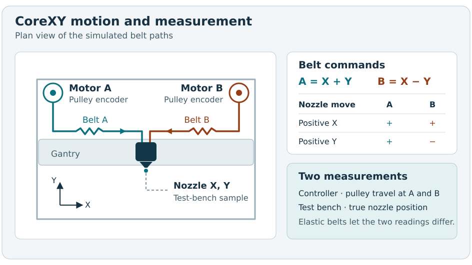
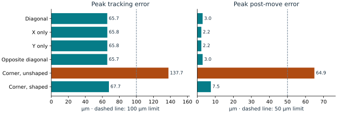
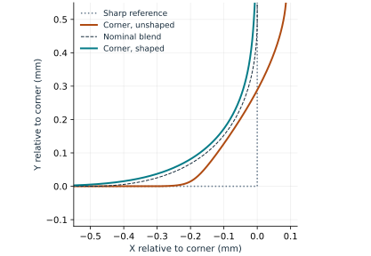

<!-- Generated by scripts/report_corexy.py. Edit design.md for the design narrative. -->

# CoreXY toolpath design and verification

## Design progression

1. **Equivalent axis.** The original model used one stepper, an elastic belt and a carriage. It compared drive
   options and established a closed-loop stepper and a 63.5 Hz input shaper as the baseline for the lead design.
2. **Two-motor stage.** The CoreXY plant resolves the two belt displacements as `X + Y` and `X - Y`. Each motor
   has rotor inertia, electrical dynamics and its own encoder and current control. The symmetric model uses the
   existing 0.67 kg effective mass per axis and two 63 kN/m elastic belt paths.
3. **Directional moves.** The four straight paths use the same 20 mm motion at 300 mm/s and 10 m/s², with the
   63.5 Hz shaper. X drives both motors in the same direction, Y reverses one motor, and the diagonals exchange
   which motor sees the higher speed. The endpoints in millimetres are (16, 12), (20, 0), (0, 20) and (16, −12).
4. **Corner.** Two 20 mm legs meet at a nominal 90° vertex. A quadratic blend starts and ends 0.5 mm from the
   vertex, at 75 mm/s, with continuous velocity and 7.95 m/s² acceleration within the blend. Both runs use this
   nominal path. The shaped run averages the command and a copy delayed by half a period at 63.5 Hz.

## How the runs were judged

Run42 executed the WebAssembly motion-controller firmware with the Modelica plant. The 50 µs traces record the
carriage positions, rotor speeds and both phase currents for each motor. Peak phase current uses the largest
absolute value of either phase. The report recomputes the metrics from each hashed trace.

The authored limits are 100 µm planar tracking error during the move (SYS-008), 50 µm peak error after the move
(SYS-006), entry into a 20 µm settling band within 50 ms (SYS-007), and a final position within 20 µm of the
target on each axis. Tracking is measured against the commanded path including shaping where enabled. A closest
approach to the sharp vertex measures geometric rounding separately.

The results apply to this simulated routing and load. Axis-specific moving mass, varying belt stiffness,
friction and gantry racking still need characterization.

## Stage and measurement points

The pulley encoders feed each stepper's field angle and current controller. Run42 uses independent nozzle-position samples to score tracking, ringing and settling.

## Results

| Run | Verdict | Tracking (µm) | Post-move (µm) | Settling (ms) | Endpoint (µm) |
| --- | --- | ---: | ---: | ---: | ---: |
| Diagonal | Pass | 65.7 | 3.0 | 0.00 | 0.4 |
| X only | Pass | 65.8 | 2.2 | 0.00 | 0.4 |
| Y only | Pass | 65.8 | 2.2 | 0.00 | 0.4 |
| Opposite diagonal | Pass | 65.7 | 3.0 | 0.00 | 0.4 |
| Corner, unshaped | Fail | 137.7 | 64.9 | 107.79 | 23.5 |
| Corner, shaped | Pass | 67.7 | 7.5 | 0.00 | 0.1 |

| Run | A speed (rpm) | B speed (rpm) | A phase peak (A) | B phase peak (A) |
| --- | ---: | ---: | ---: | ---: |
| Diagonal | 635 | 93 | 0.26 | 0.16 |
| X only | 454 | 454 | 0.24 | 0.24 |
| Y only | 454 | 454 | 0.24 | 0.24 |
| Opposite diagonal | 93 | 635 | 0.16 | 0.26 |
| Corner, unshaped | 461 | 454 | 0.34 | 0.26 |
| Corner, shaped | 454 | 454 | 0.23 | 0.23 |

The unshaped corner **failed** the verification case. The shaped corner **passed**. Peak tracking error was 137.7 µm without shaping and 67.7 µm with shaping, against a 100 µm limit.

The measured path came within 155.8 µm of the sharp vertex without shaping and within 188.6 µm with shaping. The nominal quadratic blend passes 176.8 µm from the vertex. This describes corner geometry, while tracking error is measured against each run's own commanded path.

[Summary data and trace hashes](summary.csv) · [Corner samples](corner-samples.csv) · [CoreXY model and setup](../corexy-model.md)
