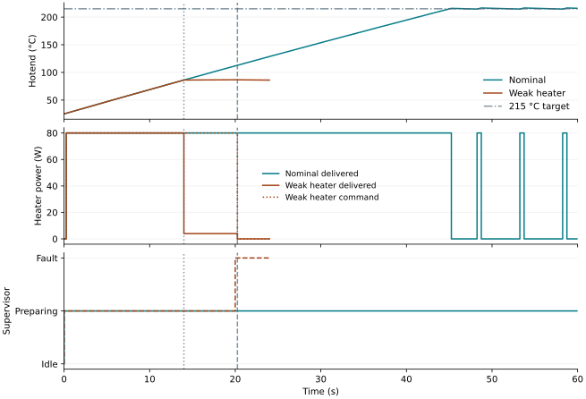

<!-- Generated by scripts/report_hotend.py from local Run42 traces. -->

# Hotend warm-up and weak-heater response

The lead hotend is modeled as an 18 J/K thermal mass with an 80 W heater at 25 °C ambient. Linear heat loss
is fitted to the trade study's 4 W mean loss across the warm-up ramp. A sampled thermostat switches heat
around the 215 °C target. Temperature feedback and heater power cross separate typed links.

The weak-heater case reduces heater authority to 5% at 14 s, so an 80 W command delivers 4 W until the
supervisor revokes permission. The watchdog checks for at least a 4 K rise over a 4 s interval when full heat
is requested and the nozzle is more than 5 K below target at both ends of the interval. Its alarm feeds the
existing print supervisor. The injected fault flag is recorded only for timing.



The dotted line marks the injected fault at 14 s. The dashed line marks the first sampled power-off state.
The nominal run remains in Preparing while bed readiness is pending. The weak-heater run ends at 24 s.

| Check | Simulated result | Requirement limit |
| --- | ---: | ---: |
| Nominal warm-up to 215 °C | 45.25 s | 60 s (SYS-009) |
| Warm-up alarm after injected power loss | 6.00 s | Included in the 10 s fault response |
| Heat permit removed, command and delivered power both zero | 6.25 s | 10 s (SYS-015) |

The cutoff result is an upper bound at the 250 ms sample interval for this injected failure. In the first
10 s of nominal warm-up, the Run42 trajectory differs from the closed-form constant-power response by
at most 7.62e-07 K. The figures are simulation results for one lumped hotend without extrusion load.
Hardware shutoff, sensor faults, and the heated bed need separate verification.

## Reproduce

Set `RUN42` to a local development build and `SPEC42_STDLIB_ROOT` and `RUN42_ENGINES` as described in the
[CoreXY setup](../corexy-model.md). From the repository root, run:

```sh
python3 scripts/verify_hotend.py
python3 scripts/report_hotend.py
```

The report uses NumPy and Matplotlib. The local Run42 verdicts and raw traces are in `build/hotend/`.
The [published samples](samples.csv) include both runs with the following SHA-256 checksums.

- Run42 executable: `ffc8415ca0334f780282d3a93adc6aee866a69003ba2b4c79e56b0449cb34645`
- Nominal: `e685952a842e8fb4fb31c31e7cd0ea90040fedce250d422ca2a20d2ada9c6787`
- Weak heater: `19f140a5453a312798d132e37053b057c7f2dbe8352720c17a8fc790b6f0a9a4`
