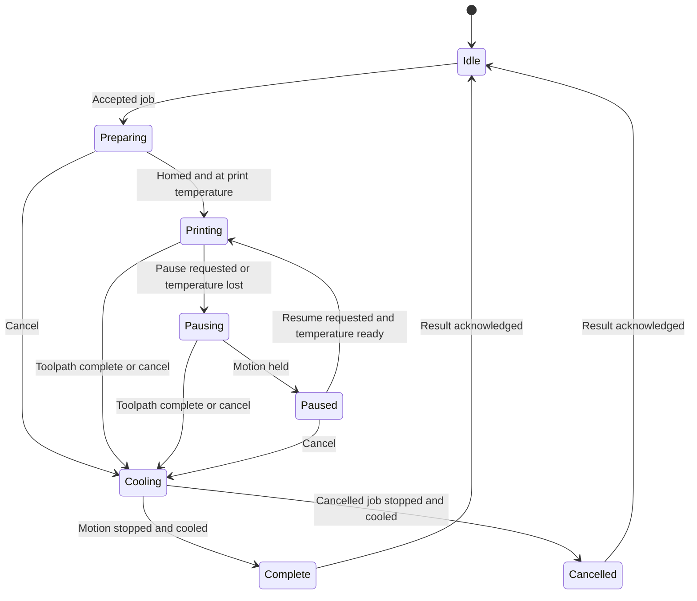

<!--
SPDX-FileCopyrightText: 2026 Elan8
SPDX-License-Identifier: MIT
-->

# Print-job supervision

The advanced controller now owns a printer firmware architecture with a job supervisor at its centre.
The supervisor coordinates one accepted job through preparation, printing, pause, cooldown and a terminal result.
The device-facing modules supply the readiness and completion events.
[Software model](../model/60_systems/MotionControlSystem/PrinterSoftware.sysml)

## Job lifecycle



Preparation starts homing and permits heat in parallel. Pausing requests a motion hold. The supervisor reports
`paused` when motion acknowledges the hold, and a resume command requires thermal readiness. Heat remains
permitted while paused, with fault monitoring active. Completion and cancellation revoke heat permission and
request motion stop. A successful toolpath completion already attests that motion is quiescent.

**Heater fault.** A reported fault can arrive in any phase. The supervisor revokes
heat permission and requests motion stop in the same event, then reports `fault`. A safety confirmation and
a separate operator reset are required to return to idle. A new fault invalidates an earlier confirmation.
The safety confirmation attests that the fault is clear and the printer is stationary and cooled.

## Interfaces and ownership

| Software component | Typed supervisor interface | Responsibility |
| --- | --- | --- |
| Job adapter | `OperatorJobPort` | Accept the prepared job, forward operator commands, and present job phase |
| Motion execution | `SupervisorMotionPort` | Receive home, run, hold or stop requests and report the resulting motion status |
| Thermal control | `SupervisorThermalPort` | Gate heating with the permission flag and report thermal readiness or cooldown |
| Safety monitor | `SupervisorSafetyPort` | Report heater faults and confirm recovery conditions |

The software model connects these ports and binds the supervisor's phase, motion request and heat permission to
its output ports. The state machine owns the decisions behind those outputs.
[Interface definitions](../model/60_systems/MotionControlSystem/PrinterInterfaces.sysml)

## Verification

The 13 authored Run42 cases cover readiness in either order, the nominal print, pause and resume interlocks,
cancellation, fault response and recovery. They inject typed events at the supervisor boundary and assert its
state and requests. The heater-fault case checks the response to a reported fault. Measuring the time from a
physical heater or sensor fault to detection and de-energization under SYS-015 requires the thermal plant and
device I/O to be bound. The stop and heat-off outputs here are commands.
[Verification cases](../verification/supervisor/SupervisorVerification.sysml)

Set `RUN42` to a local development executable and `SPEC42_STDLIB_ROOT` to the unpacked SysML standard library.
Run from the repository root:

```sh
python3 scripts/verify_supervisor.py
```

The runner loads the pinned v0.9.0 domain library and saves the discrete verdicts to `build/supervisor/verdicts.json`.
