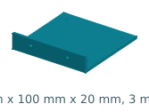

<!--
SPDX-FileCopyrightText: 2026 Elan8
SPDX-License-Identifier: MIT
-->

# The reference part

SYS-020 asks that the printer prints a 100 mm by 100 mm by 20 mm functional bracket in at most 60 minutes. This is that
bracket as the model defines it: a 3 mm base plate with four 5 mm mounting holes and a 3 mm upright wall along one edge, with
two 5 mm holes. Its solid volume is 34.8 cm^3.

[`bracket.stl`](bracket.stl) is the file a slicer reads, and the drawing is made from the same triangles.
`python3 scripts/reference_part.py` writes both from the dimensions at the top of the script; the tests check that the mesh
is closed and that the committed files are current.

The holes matter for the verification: a small circle is many short moves, which is where the acceleration limit, the
junction speeds and the input shaping decide the print time. The drawing shows the part as modelled. It is not a rendering of
a printed part.
