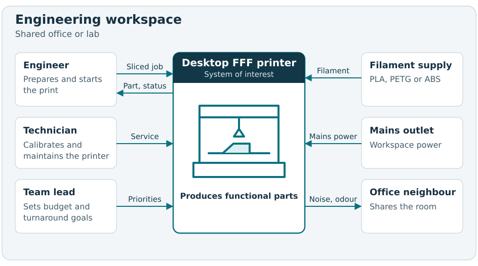
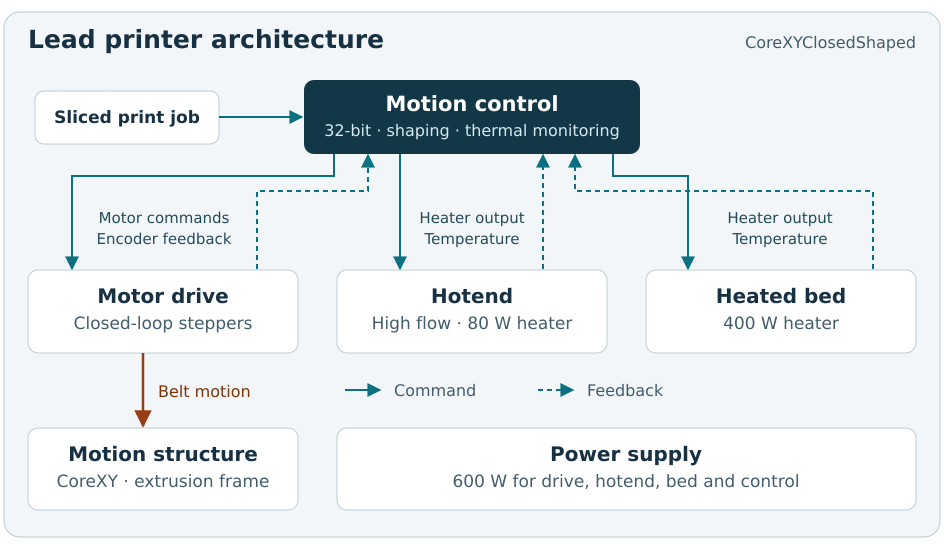

# System context and architecture

## System context



The engineer loads material and starts the sliced job, then takes the functional part from the machine. The
technician calibrates and maintains the printer. The team lead sets cost and turnaround priorities, while the
office neighbour shares the workspace. These roles and scenarios come from the
[context](../../model/00_context/Context.sysml) and [use-case model](../../model/10_usecases/UseCases.sysml).

## System architecture



The diagram summarizes the functional paths through the six subsystem choices in
[`CoreXYClosedShapedIntegration`](../../model/60_systems/00_FdmPrinter/system.sysml).
The [architecture decision record](../../records/ADR-001-lead-architecture.md) explains the selection.
The [CoreXY study](../corexy-study/README.md) shows the two-motor motion model and where verification takes its measurements.

## PDF

Set `SPEC42_KPAR_LIBRARY_PATH_DOMAIN` to the unpacked v0.9.0 domain library directory, then run from the repository root:

```sh
doc42 build docs/system-overview --workspace-root . --doc SystemOverview::report --out generated/documents
```
