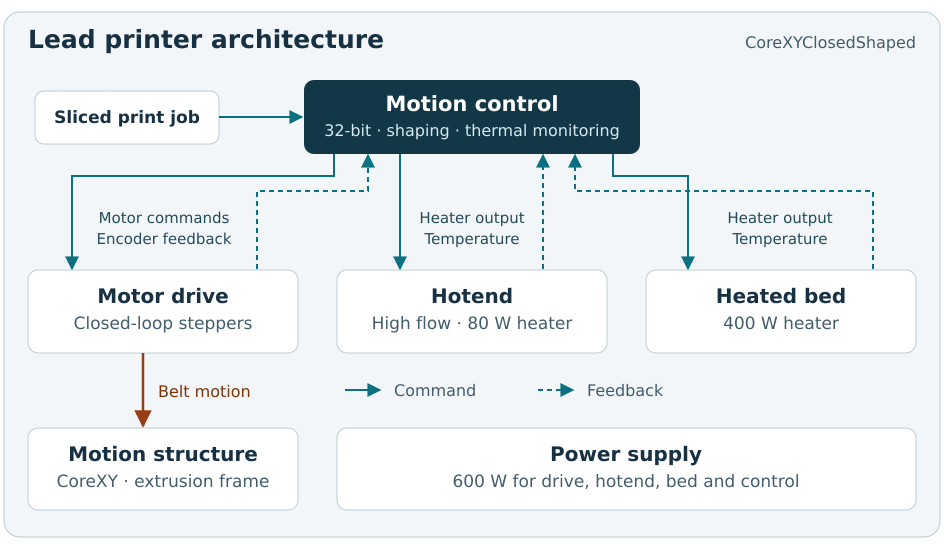

# ADR-001: Lead architecture candidate

**Status:** proposed, for review by the project owner.

## Decision

Take **CoreXYClosedShaped** as the lead architecture: a CoreXY on an aluminium extrusion frame with 6 mm belts,
closed-loop stepper motors, a high-flow hotend (80 W), a 400 W bed, a 600 W supply, and a 32-bit control board
with input shaping, pressure advance and a model-based thermal runaway monitor.

## Why

`docs/trade-study.md` compares six candidates against the 18 requirements the architecture decides (the rest
need a simulation), and `docs/axis-verification.md` simulates one axis with each drive. Findings, all read from the model:

- **A bed-slinger cannot reach the resonance, whatever the electronics.** Its worst axis is the bed and the
  part, 1.6 kg on a single belt, so the first resonance is 38 Hz against the 50 Hz required (SYS-005), its
  footprint is 12 percent over the limit (SYS-017), and the belt stretches so much under acceleration that the
  tracking limit (SYS-008) allows only 4 m/s^2, not the 10 required (SYS-003). With every electronic improvement it
  still fails those four. Input shaping hides the ringing (21 um) but not the stretch.
- **Input shaping is what meets the ringing limit.** Without it the CoreXY's residual vibration at
  10,000 mm/s^2 is 51 um against 50 um (SYS-006), and the ringing limit alone caps the acceleration at
  9,800 mm/s^2 (SYS-003). With the shaper the residual vibration is 6 um and the ringing limit allows 78 m/s^2.
  The simulation of one axis (`docs/axis-verification.md`) confirms it: without a shaper the carriage does not
  settle within 20 um, with one it does, even when the shaper is tuned 11 percent off.
- **The belt, not the motor, limits the acceleration.** Every shaped candidate's motors allow 59 to 104 m/s^2 and
  the ringing limit 78, but the belt stretches by m a / k, and the tracking error of a move is about 1.4 times that
  (simulated: 72 to 80 um at 10 m/s^2 for all three drives, growing in proportion). The 0.1 mm tracking limit
  (SYS-008) therefore allows 13 m/s^2 for the lead candidate: a margin of 34 percent over the 10 m/s^2 required. A
  stiffer belt is the way to more; the wide-belt candidate allows 19 m/s^2.
- **A basic 8-bit board is out.** It limits the step rate to 30 kHz, which on a CoreXY diagonal is 265 mm/s
  (SYS-002), and its runaway check takes 40 s against 10 s (SYS-015), and it holds the nozzle to 2 K, not 1 K.
- **Open-loop steppers fail only the noise limit** (56 against 55 dB(A), SYS-016) and save 80 EUR. Closed-loop
  steppers also keep the error budget at 71 um instead of 76 um, cannot lose steps, and damp the axis: simulated
  with a trapezoidal move and no shaper, the closed-loop stepper settles in 40 ms where the open-loop one never
  does (the derivative term of its position loop is the damping).
- **Servos and a steel frame are the most accurate but not worth it.** The error budget is 40 um instead of 71
  um, but the bill of parts is 887 EUR against 750 (SYS-019) and the servos' peak power overloads the 600 W
  supply by 2 percent (SYS-014). On the same axis a servo does not do better than a closed-loop stepper in the
  simulation (2.4 against 1.3 um of residual vibration with a shaper, 73 against 72 um of tracking error): the
  belt, not the drive, decides.
- **The thermal error is the biggest term of the error budget.** The frame grows 58 um over a 10 K warm-up on
  aluminium and 30 um on steel; it is larger than the motor positioning error of every design.

## What it commits us to

- The shaper is tuned to the measured resonance of the axis, so the printer needs a calibration step, and the
  resonance must stay put (belt tension, toolhead mass).
- The acceleration, ringing and accuracy figures are estimates from a one-mass-on-one-spring model (A-MECH-1),
  checked for one axis and one move by simulation. The 34 percent acceleration margin rests on the belt stiffness
  (1.26e5 N/m, an estimate): a measured stiffness is the first thing to confirm. The simulation of a toolpath
  (SYS-020) is next.
- The 600 W supply leaves 7 percent margin; the thermal model of the frame is a first estimate.

## Still open

SYS-007 (settling), SYS-008 (tracking) and SYS-020 (reference print time) are decided by simulation, not by the
architecture.
